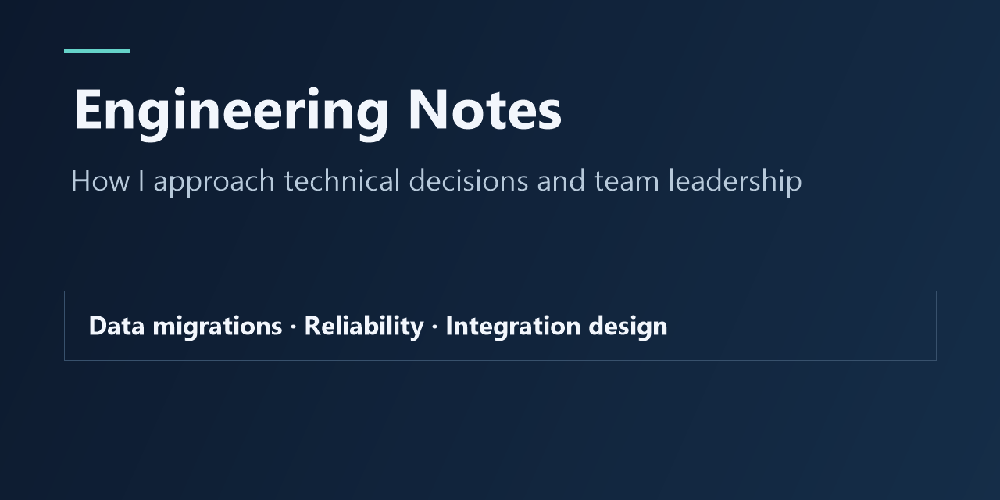

# Engineering Notes

Practical notes on data safety, reliability, modernization, integration architecture and leading engineering teams. Each note focuses on a decision: what to look for, what the evidence can tell you and what to do next.

The notes draw on my engineering and team leadership experience. The scenarios used to illustrate decisions are hypothetical, and the runnable examples are written for this repository. They are not employer or client case studies. No third-party source code, documentation, identifiers, infrastructure values or non-public measurements are intentionally included.

## Notes

| Area | Note | Focus |
| --- | --- | --- |
| SQL and data | [Designing restartable data migrations](sql/designing-restartable-data-migrations.md) | Convergent state, concurrency, transactions, restartability and verification |
| Reliability | [Diagnosing persistent failures caused by negative caching](reliability/diagnosing-persistent-negative-cache-failures.md) | Evidence correlation, causal confidence and safe negative caching |
| Modernization | [Planning a safe TFVC-to-Git migration](modernization/planning-tfvc-to-git-migration.md) | History conversion, sensitive-data controls, freeze, cutover and audit linkage |
| Architecture | [Protocol-neutral capability layers for AI channels](architecture/protocol-neutral-capability-layers-for-ai-channels.md) | Application boundaries, thin adapters, authorization and failure semantics |
| AI-assisted engineering | [When an engineering standard changes, what changes for the agent?](https://github.com/mmaric27/engineering-notes/blob/main/architecture/when-an-engineering-standard-changes.md) | Verify which rule revision the assistant loaded, evaluate its decision, and test the resulting software against a lost response. |
| Team leadership | [How I approach team wellbeing and development](team-leadership/team-wellbeing-and-development.md) | Turning one-to-one feedback into action without confusing delivery metrics with individual wellbeing |

## Working Principles

1. Measure the current state before changing it.
2. Separate symptoms, contributing conditions and root causes.
3. Make unknowns and missing evidence explicit.
4. Design changes to be observable and recoverable, with explicit rollback or resume behavior where applicable.
5. Verify outcomes independently of the implementation path.
6. Keep modernization steps small enough to review and either reverse or recover from.

## About

Written by [Marko Marić](https://www.linkedin.com/in/mark-om42), a senior backend engineer working on data modelling, enterprise integrations and solution design.

Generative AI assisted with outlining and copy-editing. The author selected the topics, reviewed the technical content and approved the published wording. This statement records editorial review only and does not claim ownership of, or permission to publish, any third-party material.

## License

Repository documentation and artwork are licensed under [CC BY 4.0](LICENSE). Source code in `examples/` is licensed under the [MIT License](examples/LICENSE).
